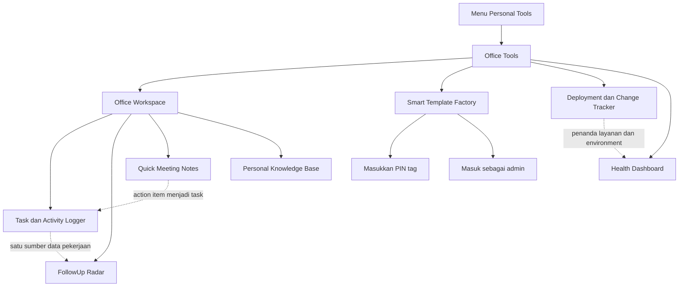
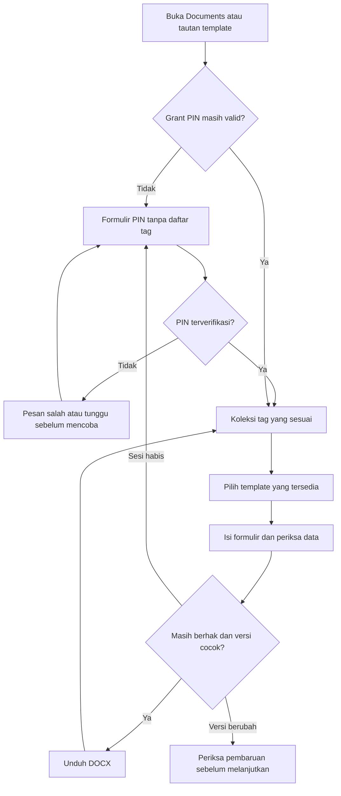
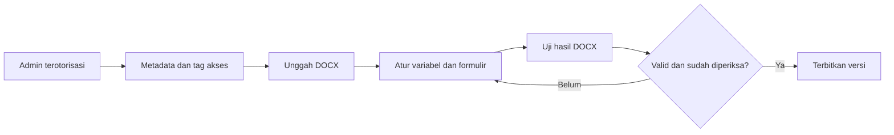

# UX: Office Workspace dan tiga aplikasi pendamping

Tanggal: 25 Oktober 2026. Status: spesifikasi alur yang disetujui untuk implementasi, bukan hasil riset pengguna. Status implementasi dan walkthrough: [panduan Office Suite](office-suite.md).

Sumber aturan: [PRD](office-suite-prd.md). Aturan yang dapat ditegakkan server: [logika](office-suite-logic.md). Nomor D, P, dan AC merujuk PRD. Dokumen ini mengatur urutan, keputusan, umpan balik, dan pemulihan; tidak menetapkan palet atau desain visual baru.

## 1. Kontrak pengalaman

| Pengguna dan tujuan | Prasyarat | Tanda berhasil |
| --- | --- | --- |
| Pemegang PIN mencari template lembaga | Mengetahui PIN tag dari admin | Koleksi yang sesuai terbuka dan DOCX dapat diunduh. |
| Admin menyediakan/memperbarui template | Akun dengan hak admin template | Versi valid terbit pada tag yang dipilih; versi gagal tidak mengganggu pengguna. |
| Pegawai mencatat pekerjaan | Akun dan akses workspace | Aktivitas tercatat dan masuk laporan periode. |
| PIC menindaklanjuti permintaan | Task dan pihak yang ditunggu | Riwayat komunikasi dan hasil terhubung ke task semula. |
| Notulis menerbitkan notulensi | Akses rapat | Keputusan terdokumentasi dan action item yang dipilih menjadi task. |
| Anggota mencari panduan | Akses artikel | Artikel yang sesuai izin ditemukan beserta versi/tanggalnya. |
| Operator mencatat perubahan | Akses layanan/environment | Release dan rollback tercatat pada timeline yang benar. |
| Operator memeriksa layanan | Monitor terkonfigurasi dan worker aktif | Kondisi serta umur data jelas; insiden dapat dibedakan dari data yang belum tersedia. |

Tidak ada persona, angka penghematan waktu, kutipan pengguna, atau klaim kemudahan yang dibuat-buat. Alur berikut merupakan walkthrough berbasis kebutuhan dan kode yang diperiksa.

## 2. Peta navigasi

Sesuai perubahan 30 Oktober 2026, katalog `/menu` memakai satu kartu Office Tools. `/office` masuk ke daftar pekerjaan terakhir atau default Task; tidak menambah submenu dashboard kelima. Aplikasi lain dipilih dari menu kiri yang tetap tersedia sebelum login, sehingga Documents dapat dibuka menggunakan PIN tanpa akun. `/document` tetap mengarah ke `/documents` dalam kelompok tersebut. Workspace aktif terlihat pada aplikasi akun. Tag Documents terlihat hanya setelah PIN valid. Rute akun bersama bukan aplikasi baru dalam katalog.

## 3. Masuk akun dan berpindah aplikasi

1. Pengguna membuka Office, Change Tracker, Monitoring, atau admin Documents.
2. Jika sesi akun valid, buka tujuan dengan izin yang berlaku.
3. Jika belum masuk, tampilkan halaman login bersama dan tujuan kembali yang aman.
4. Pengguna mengisi email/kata sandi. Status proses terlihat; pengiriman berulang dicegah.
5. Login berhasil mengembalikan pengguna ke tujuan. Jika role tidak cukup, tampilkan penolakan akses dan tautan kembali, bukan halaman login berulang.
6. Pengguna baru mendaftar hanya dengan email dan kata sandi, lalu langsung masuk tanpa verifikasi email. Jika akun berhasil dibuat tetapi sesi gagal dibuka, arahkan mencoba login. Pengguna juga dapat meminta reset; pesan permintaan reset tidak membocorkan apakah email terdaftar dan pengirim email perlu disiapkan.
7. Workspace pribadi tersedia satu kali; undangan tim tidak diam-diam memindahkan pekerjaan pribadi.
8. Berpindah aplikasi tidak meminta login lagi selama sesi valid.

Keluar akun diberi keterangan bahwa empat aplikasi pada perangkat ini akan keluar dan koleksi PIN Documents akan dikunci. Sesi FinTrack tidak ikut berubah. Mengunci Documents tidak mengeluarkan pengguna dari Office. Masuk FinTrack tetap melalui alurnya sendiri.

Jika sesi habis ketika menyunting, hentikan simpan dan tawarkan login kembali ke konteks awal. Input dapat dipertahankan di memori tab, tidak di localStorage atau URL. Sebelum input ditampilkan lagi, identitas dan akses objek harus sama; bila berubah, buang input sensitif tersebut. Refresh/menutup tab dapat menghilangkan isian yang belum tersimpan dan harus diberitahukan.

## 4. Documents untuk pemegang PIN

### Gerbang PIN

- Judul menjelaskan bahwa PIN membuka koleksi dokumen instansi/lembaga/divisi.
- Satu field PIN dengan input numerik dan tombol tampil/sembunyikan; nilainya tetap string agar nol awal terjaga.
- Tombol `Buka dokumen` dan tautan `Masuk sebagai admin`. Pengguna biasa tidak diarahkan membuat akun.
- Jangan menampilkan daftar instansi, jumlah koleksi, nama template, atau saran PIN sebelum akses sah.
- Tautan generator langsung menyimpan tujuan internal. Setelah PIN valid, buka template itu hanya jika termasuk tag yang terbuka; jika tidak, tampilkan katalog tag yang sah dengan pesan umum.

### Katalog dan pergantian kelompok

- Tampilkan nama tag aktif, pencarian nama/jenis, filter metadata dalam koleksi, serta tombol `Ganti PIN` dan `Kunci akses`.
- Satu tag aktif per sesi merupakan P-01. PIN baru yang salah mempertahankan koleksi lama. PIN baru yang benar mengganti koleksi setelah pengguna menyetujui perpindahan bila ada formulir belum tersimpan.
- Koleksi kosong memakai pesan `Belum ada template yang tersedia untuk kelompok ini`, tanpa mengungkap tag lain.
- Hasil pencarian kosong menawarkan hapus filter; kegagalan memuat menawarkan coba lagi. Kedua kondisi tidak disamakan.
- Pergantian atau pencabutan PIN mengunci akses pada permintaan berikutnya. Klien membersihkan metadata/formulir sensitif yang ditampilkan ketika mengetahui grant tidak berlaku.

### Formulir dan unduh

- Tampilkan nama template, kelompok akses, versi, isian wajib, dan batas baris sebelum pengguna mengisi.
- Pertahankan kemampuan Surat Tugas dan Perjadin. Identitas instansi pada metadata tidak otomatis menimpa teks yang tercetak dalam file Word.
- Salah input ditunjukkan pada field; input valid tetap terjaga. Tombol unduh menampilkan status proses.
- Ketika file siap, mulai unduhan dan tampilkan konfirmasi file tersedia. Aplikasi tidak dapat membuktikan pengguna sudah membuka file di Word.
- Jika versi berubah, tampilkan ringkasan perubahan dan minta muat ulang formulir. Field yang tidak berubah boleh dipetakan kembali di memori, tetapi harus ditinjau pengguna.
- Jika tag dipindah atau template dinonaktifkan, hentikan ekspor; jangan menawarkan mengulang endpoint lama sebagai jalan pintas.
- Hasil dan draft tidak disimpan permanen di server pada MVP. Beri tahu bahwa menutup tab dapat menghilangkan isian.

## 5. Admin tag dan template

### Masuk dan orientasi

1. Pilih `Masuk sebagai admin`, atau buka `/documents/admin`.
2. Gunakan sesi akun bersama. Role admin template diperiksa server.
3. Tampilkan dua area kerja di dalam admin: `Template` dan `Tag akses`. Ini bukan tambahan submenu Office.
4. Akun tanpa hak admin melihat penjelasan akses terbatas; tidak dapat mengajukan diri menjadi admin lewat perubahan profil.

### Membuat tag dan PIN

1. Isi nama tag serta kategori instansi/lembaga/divisi.
2. Tetapkan PIN sesuai batas yang ditampilkan. Beri tahu bahwa PIN lama tidak dapat dilihat kembali.
3. Simpan. Nama tag yang sudah ada dan PIN yang sudah digunakan ditolak dengan pesan yang hanya terlihat admin.
4. Bagikan PIN melalui jalur yang dipilih admin di luar aplikasi. Produk tidak otomatis mengirim pesan kepada pegawai.
5. Ganti/cabut PIN menggunakan dialog yang menjelaskan dampaknya terhadap seluruh koleksi dan sesi aktif.
6. Konfirmasi berhasil menyebutkan kelompok yang berubah tanpa mencetak PIN di toast, log, atau riwayat.

### Menambah atau mengganti template

Variabel yang didukung ditampilkan beserta label, tipe, kewajiban, opsi, dan aturan grup. Placeholder terdeteksi boleh menjadi bantuan; deteksi tidak menggantikan konfigurasi admin atau pengujian hasil Word.

Saat mengganti file, versi aktif lama tetap terbit. Unggahan baru menjadi draft. Kegagalan upload, validasi, atau penyimpanan tidak menampilkan keberhasilan palsu dan dapat dicoba ulang tanpa duplikat. Bila dua admin menyunting bersamaan, tampilkan konflik dan pilihan memuat versi terkini; perubahan admin lain tidak ditimpa diam-diam.

### Memindahkan, menonaktifkan, dan menghapus

- Pindah tag: tampilkan tag lama/baru serta dampak akses; konfirmasi sebelum berlaku. Dokumen tidak otomatis berubah kop atau isi file.
- Nonaktifkan: template hilang dari pengguna biasa, tetapi admin dapat memulihkan.
- Hapus: sebutkan bahwa katalog dan unduhan baru akan dihentikan. Gunakan penghapusan logis pada MVP; admin dapat memulihkan selama masa retensi.
- Tag berisi template nonhapus tidak dapat dihapus. Tawarkan pindahkan template atau arsipkan tag.
- Tidak ada kemampuan menarik file yang telah diunduh dari perangkat pengguna.

## 6. Office: pekerjaan dan tindak lanjut

1. Pilih workspace, lalu buat task dengan judul, PIC, tenggat, prioritas, kategori, dan lingkup.
2. Catat aktivitas harian pada task: apa yang dikerjakan, hasil, kendala, dan bukti.
3. Jika menunggu pihak lain, tambahkan follow-up pada task yang sama; cantumkan pihak, tanggal permintaan, dan target respons.
4. FollowUp Radar menampilkan yang perlu ditindaklanjuti, terlambat, serta riwayatnya. Membuka item membawa pengguna ke konteks task.
5. Catat komunikasi atau respons. Menyelesaikan follow-up tidak otomatis menyelesaikan task.
6. Menyelesaikan task dengan follow-up terbuka meminta pengguna menyelesaikan atau membatalkan seluruh follow-up terlebih dahulu.
7. Pilih periode laporan, tinjau aktivitas dan hasil, lalu ekspor. Data di luar izin tidak dimasukkan.

Status menunggu pada task dan status follow-up ditampilkan terpisah. Tugas yang sudah selesai terlambat tidak terus muncul sebagai overdue aktif; riwayat terlambat tetap dapat dilaporkan. Pengingat muncul di aplikasi setelah worker mencatatnya, termasuk bila pengguna tidak membuka aplikasi saat waktunya tiba.

## 7. Office: rapat dan pengetahuan

Rapat: buat draft → isi identitas/agenda/pembahasan → catat keputusan → tulis action item → pilih `Jadikan task` → periksa PIC/tenggat/lingkup → buat tautan task → finalkan notulensi → unduh. Rapat boleh tidak memiliki task. Tombol konversi yang sudah selesai membuka task yang ada, bukan membuat ulang. Revisi notulensi final menghasilkan versi baru; pembaruan task merupakan tindakan terpisah yang jelas.

Knowledge Base: cari artikel yang berhak dibaca → lihat isi dan tanggal/versi → ikuti tautan referensi yang diizinkan. Penulis membuat draft, memilih pribadi atau workspace, menyunting, lalu menerbitkan. Riwayat versi memungkinkan membandingkan dan memulihkan sebagai revisi baru. Label dan tag artikel bukan tag PIN Documents; keduanya tidak saling memberikan akses.

## 8. Change Tracker dan Monitoring

Change Tracker: pilih workspace → layanan → environment → catat release, pelaksana, waktu, perubahan dan bukti → simpan status aktual → catat hasil. Rencana rollback dan pelaksanaannya ditampilkan terpisah. Tombol menggunakan istilah `Catat rollback`, bukan `Jalankan rollback`, karena produk tidak menjalankan operasi infrastruktur.

Monitoring: pilih layanan/environment → atur target yang diizinkan, interval, timeout dan status yang diharapkan → aktifkan → tampilkan `Menunggu pemeriksaan pertama` → lihat hasil serta waktu terakhir. Penanda release dapat dibuka ke Change Tracker tanpa memindahkan menu aplikasi.

Data lama harus diberi label kedaluwarsa. Monitor dijeda atau dalam pemeliharaan memiliki penjelasan, bukan indikator hijau. Pemulihan ditampilkan sesudah ambang keberhasilan, bukan hanya satu refresh halaman. Detail target internal atau pesan error upstream tidak diumumkan ke anggota yang tidak memiliki izin.

## 9. Kontrak kegagalan dan pemulihan

| Keadaan | Pengalaman yang diwajibkan |
| --- | --- |
| PIN salah/tidak aktif | Pesan umum `PIN tidak valid atau tidak tersedia`; jangan mengungkap tag yang cocok sebagian. |
| Percobaan dibatasi | Jelaskan waktu tunggu dari server dan nonaktifkan pengiriman sementara; tidak mengunci seluruh kantor permanen. |
| Auth/storage/database tidak tersedia | Pesan gangguan layanan dan retry; tidak membuka katalog sebagai fallback. |
| Sesi habis atau izin dicabut | Kunci tampilan terlindungi, jelaskan langkah masuk ulang; input hanya dipulihkan setelah izin sesuai. |
| Tag terbuka tetapi kosong | Jelaskan belum ada template, sediakan ganti PIN/kunci akses. |
| File/variabel DOCX tidak valid | Tunjukkan kesalahan kepada admin pada draft; pengguna tetap memakai versi aktif lama. |
| Penyimpanan berakhir dengan hasil tidak diketahui | Periksa status operasi sebelum meminta ulang; jangan menyatakan pasti gagal atau membuat salinan baru. |
| Konflik revisi | Tunjukkan data telah berubah dan minta muat ulang atau gabungkan perubahan secara sadar. |
| Template berpindah tag saat formulir terbuka | Hentikan akses baru; jangan mengekspos kelompok barunya kepada pengguna lama. |
| Worker berhenti | Tampilkan umur data/antrean; tidak mengklaim seluruh layanan sehat. |

## 10. Walkthrough yang harus dijalankan

| ID | Skenario dan hal yang diperiksa | PRD |
| --- | --- | --- |
| UX-01 | Pengunjung dari `/menu` memasukkan PIN Kemen PU, memilih A, mengisi dan mengunduh; C tidak tampak atau dapat diakses langsung. | AC-03 |
| UX-02 | Dari koleksi Kemen PU, coba PIN lain yang salah lalu PIN IT yang benar; koleksi berganti hanya setelah berhasil. | AC-04 |
| UX-03 | Admin mencabut PIN ketika pengguna membuka formulir; permintaan berikutnya ditolak dan ada jalan kembali. | AC-04 |
| UX-04 | Admin mengganti file dengan variabel salah; draft tetap dapat diperbaiki, versi terbit tetap dapat dipakai. | AC-06 |
| UX-05 | Login Office, buka admin Documents tanpa role, lalu buka Change Tracker dengan role cukup; tidak ada loop login atau kenaikan hak. | AC-02/05 |
| UX-06 | Login/keluar FinTrack saat Office terbuka; ulangi arah sebaliknya dan dengan grant PIN aktif. | AC-02 |
| UX-07 | Task berisi dua follow-up; selesaikan satu dan lihat Radar/task/laporan tanpa duplikasi. | AC-08 |
| UX-08 | Klik konversi action item dua kali, revisi rapat, dan buka task; hubungan tetap satu. | AC-09 |
| UX-09 | Cari artikel pribadi sebagai anggota dan admin workspace lain; judul maupun cuplikan tidak bocor. | AC-10 |
| UX-10 | Catat rollback dan buka timeline monitor dengan environment berbeda; tidak ada operasi infrastruktur atau penanda salah. | AC-11 |
| UX-11 | Hentikan simulasi hasil worker; status menjadi data kedaluwarsa dan hasil hilang tidak dianggap sukses. | AC-12 |
| UX-12 | Keyboard, layar kecil, refresh, error jaringan, dan sesi habis pada alur utama tetap mempunyai pesan dan pemulihan. | AC-13 |

Status walkthrough aktual dicatat dalam panduan implementasi. Walkthrough dengan data uji tidak menggantikan pengujian usability pengguna kantor atau verifikasi Supabase production. Tidak ada klaim bahwa alur telah terbukti lebih cepat atau intuitif.
